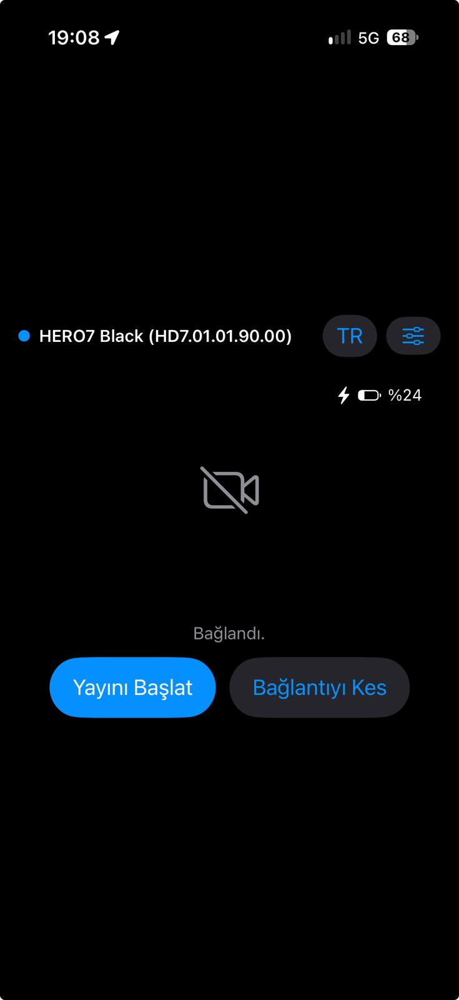
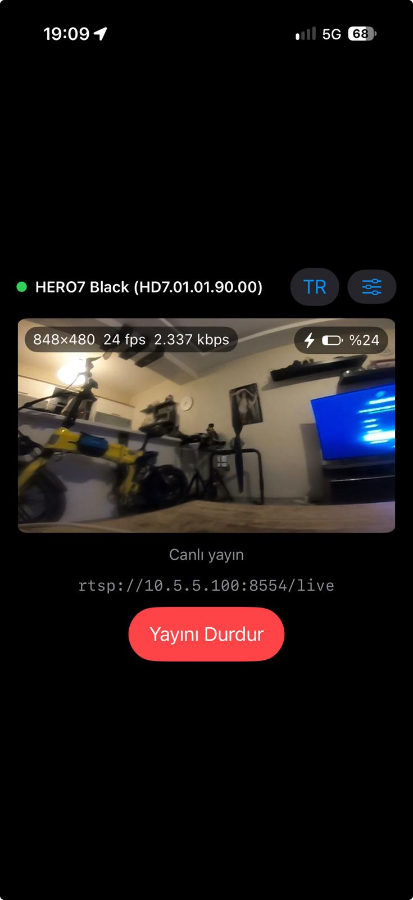
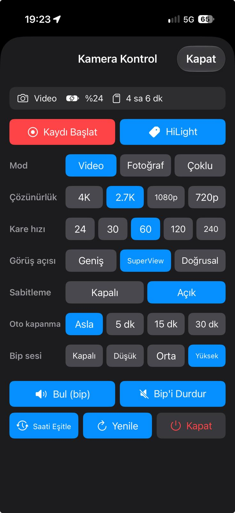

# GoProLive

A SwiftUI app for iPhone, iPad and Mac that shows the live preview of a GoPro HERO7 over Wi-Fi, re-broadcasts it as an RTSP stream, and lets you control the camera remotely. No third-party dependencies.

  
  
  

## Features

- **Live preview** — low-latency, hardware-decoded H.264 video from the camera (848×480, about 30 fps on a HERO7 Black).
- **Fullscreen** — tap the video to fill the screen, tap again to go back. In portrait the picture is rotated to landscape; on the Mac the window also enters fullscreen.
- **Overlays** — resolution, frame rate and bitrate, the camera's battery level and charging state, and a recording indicator.
- **RTSP re-broadcast** — while streaming, the app serves the video at `rtsp://<device IP>:8554/live` so other devices on the same network can watch it in VLC, ffplay and similar players.
- **Camera control page** — start/stop recording, HiLight tag, mode, video resolution, frame rate, field of view, stabilization, auto power off, beep volume, locate, clock sync and power off. The value currently set on the camera is highlighted.
- **Turkish and English** — switch with the TR/EN button. Turkish is the default; the choice is remembered.
- **iOS and macOS** — one target builds for iPhone, iPad and Mac.

## Requirements

- Xcode 16 or later
- iOS 17 or later, or macOS 14 or later
- A GoPro that speaks the `gpControl` Wi-Fi API. Developed and tested with a HERO7 Black (firmware HD7.01.01.90.00).

## Getting started

1. Open `GoProLive.xcodeproj` in Xcode.
2. Under Target > Signing & Capabilities, pick your Team (change the bundle identifier if needed).
3. Choose an iPhone or "My Mac" as the destination and run.
4. On the camera: Preferences > Connections > Connect Device > GoPro App. This turns on the camera's Wi-Fi access point.
5. Join the GoPro Wi-Fi network on your device and open the app.
6. Allow the "Local Network" permission when asked, then tap **Yayını Başlat** (Start Stream).

## Watching the RTSP stream

While the stream is running, the address is shown under the video. The viewing device must be on the same network as the device running the app, which normally means the GoPro's Wi-Fi.

    ffplay -rtsp_transport tcp -fflags nobuffer -flags low_delay rtsp://<device IP>:8554/live

In VLC, lower the network caching value (100–200 ms) to reduce delay.

- TCP transport only (RTP interleaved). Clients that ask for UDP are told it is unsupported and fall back to TCP.
- Video only (H.264), passed through without re-encoding. No audio.
- On iPhone the stream stops when the app goes to the background.

## How it works

- `GET http://10.5.5.9/gp/gpControl/info` reads the camera model and firmware.
- `GET http://10.5.5.9/gp/gpControl/execute?p1=gpStream&a1=proto_v2&c1=restart` starts the preview stream.
- The camera sends MPEG-TS (H.264) to UDP port 8554 of the device that asked for it.
- A UDP keep-alive (`_GPHD_:0:0:2:0.000000\n`) is sent to `10.5.5.9:8554` every 2 seconds; if no data arrives for 4 seconds the stream is requested again.
- `GET http://10.5.5.9/gp/gpControl/status` is polled for battery, mode, recording state and current settings.
- Pipeline: `UDPReceiver` → `TSDemuxer` → `H264Renderer` (`AVSampleBufferDisplayLayer`) and, in parallel, `RTSPServer`.

## Limitations

- The HERO7 Wi-Fi preview is 848×480. The resolution and frame rate settings on the control page affect what is recorded to the SD card, not the preview.
- The preview follows the aspect ratio of the camera's capture mode. To keep it 16:9, the app switches the camera to video mode when the stream starts and, if a 4:3 video resolution is selected, changes it to 1080p.
- Wi-Fi range is short: roughly 10–30 m in the open.
- On a drone, the camera's 2.4 GHz Wi-Fi can interfere with the radio control link. Use the 5 GHz band or keep the camera's Wi-Fi off in flight.

## Project layout

| File | Purpose |
| --- | --- |
| `GoProClient.swift` | HTTP commands, keep-alive, status polling, statistics, watchdog |
| `UDPReceiver.swift` | BSD UDP socket |
| `TSDemuxer.swift` | MPEG-TS → video PES |
| `H264Renderer.swift` | Annex-B → `CMSampleBuffer` → screen |
| `RTSPServer.swift` | RTSP server, H.264 → RTP over TCP |
| `ContentView.swift`, `VideoLayerView.swift` | Main screen and video view |
| `CameraControlView.swift` | Camera control page |
| `Localization.swift` | Turkish/English strings |

## License

See [LICENSE](LICENSE).
